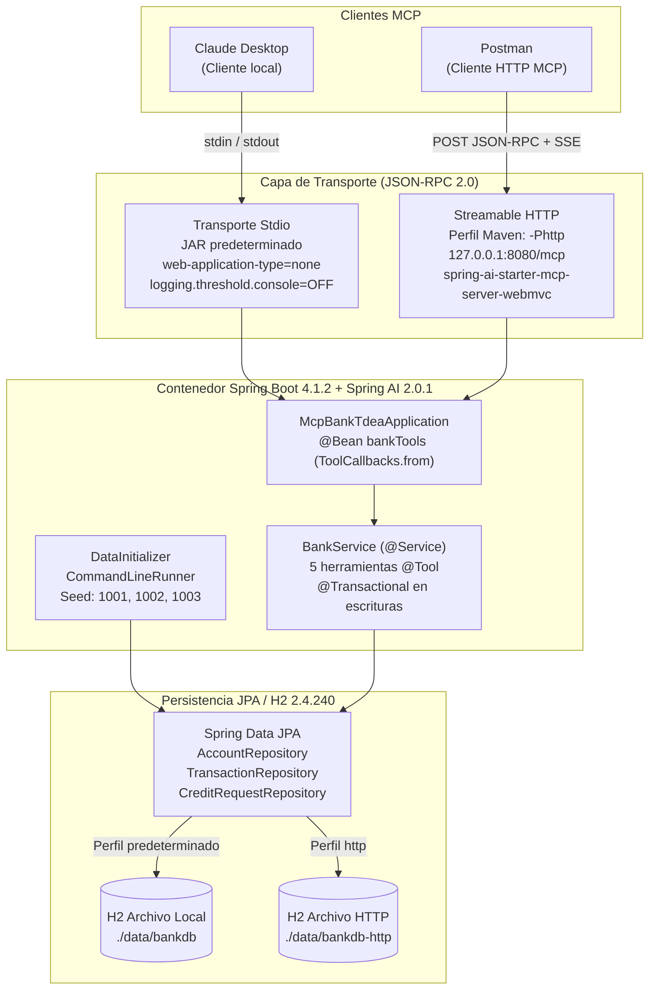
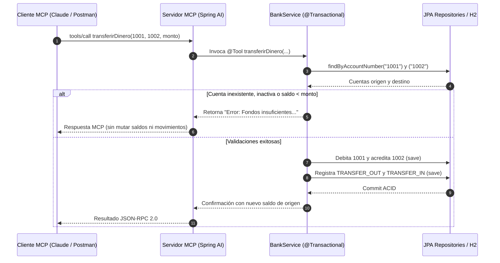
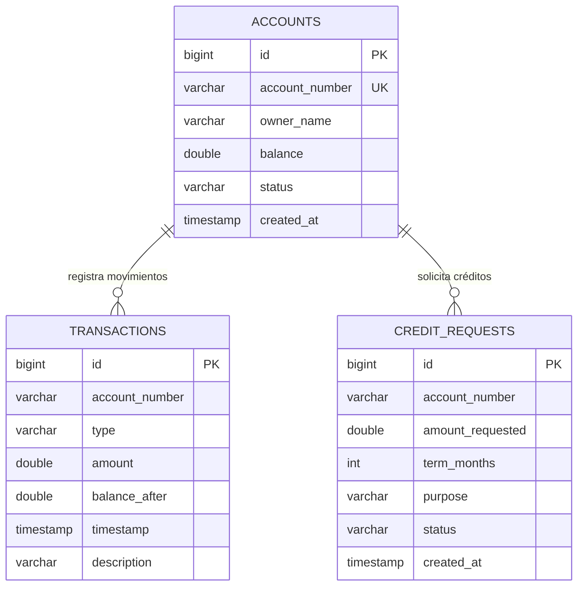

# Servidor MCP Bancario — TdeA

Laboratorio académico desarrollado con **Spring Boot 4.1.2**, **Spring AI 2.0.1**, **Java 21** y **H2 Database**. Implementa el ejercicio bancario de la página 17 de [Guia-LaboratorioMCPTDEA.pdf](Guia-LaboratorioMCPTDEA.pdf) exponiendo operaciones financieras mediante el protocolo **Model Context Protocol (MCP)** sobre dos transportes: **Stdio** (para Claude Desktop) y **Streamable HTTP** (para Postman).

> Proyecto académico con datos ficticios. No conecta con entidades financieras ni procesa dinero real.

---

## Arquitectura del sistema

El servidor comparte una única capa de dominio (`BankService`) y repositorios Spring Data JPA sobre H2, empaquetándose en dos artefactos independientes según el transporte requerido:



> **Nota sobre concurrencia de archivo:** H2 embebida bloquea el archivo de base de datos por proceso. Para consultar desde Postman los datos generados por Claude Desktop, primero se debe cerrar Claude y luego iniciar el perfil HTTP apuntando a `./data/bankdb` en modo de solo lectura (`ACCESS_MODE_DATA=r`).

---

## Flujo transaccional (`transferirDinero`)

Las operaciones de escritura (`consignarDinero`, `transferirDinero` y `solicitarCredito`) se ejecutan dentro de un límite `@Transactional` para garantizar atomicidad:



---

## Modelo de datos



---

## Herramientas MCP expuestas

| Herramienta | Tipo | Descripción |
| :--- | :--- | :--- |
| `consultarSaldo` | Lectura | Devuelve titular, estado y saldo disponible en COP por número de cuenta. |
| `consignarDinero` | Escritura (`@Transactional`) | Acredita fondos a una cuenta activa y registra un movimiento `DEPOSIT`. |
| `transferirDinero` | Escritura (`@Transactional`) | Valida cuentas y saldo; debita origen, acredita destino y registra `TRANSFER_OUT` / `TRANSFER_IN`. |
| `solicitarCredito` | Escritura (`@Transactional`) | Montos `<= 10.000.000 COP` se aprueban (`APPROVED`) y desembolsan (`CREDIT_DISBURSEMENT`); mayores quedan `PENDING`. |
| `listarMovimientos` | Lectura | Lista el historial de movimientos ordenado cronológicamente por cuenta. |

---

## Construir y usar con Claude Desktop (Stdio)

```powershell
.\mvnw.cmd clean package
```

El JAR predeterminado se genera en `target/mcp-bank-tdea-0.0.1-SNAPSHOT.jar` y utiliza transporte **Stdio**.

1. En Claude Desktop, ir a **Configuración > Desarrollador > Editar configuración** para abrir el archivo de configuración activo en tu equipo.
2. Conservar tus preferencias existentes y agregar el bloque `mcpServers` tomando como referencia [claude_desktop_config.example.json](claude_desktop_config.example.json), reemplazando `<RUTA_ABSOLUTA_PROYECTO>` por la ruta real de tu repositorio.
3. Reiniciar completamente Claude Desktop.

> Las operaciones de escritura solicitan confirmación del usuario en el cliente MCP. Las cuentas semilla (`1001`, `1002`, `1003`) solo se crean si la base de datos está vacía.

---

## Probar en Postman por Streamable HTTP

```powershell
.\mvnw.cmd -Phttp -DskipTests package
java -jar target/mcp-bank-tdea-http-0.0.1-SNAPSHOT.jar --spring.profiles.active=http
```

- El perfil `http` usa exclusivamente `spring-ai-starter-mcp-server-webmvc`, escucha en `http://127.0.0.1:8080/mcp` y almacena su base independiente en `data/bankdb-http`.
- El JAR HTTP tiene nombre distinto para no sobrescribir el JAR usado por Claude Desktop.
- En Postman: **New > MCP > HTTP**, ingresar `http://127.0.0.1:8080/mcp` y pulsar **Connect** (el endpoint transporta mensajes MCP JSON-RPC, no es una API REST convencional).
- Para reproducir las consultas HTTP mediante colección estándar, importar [MCP-Bancario-Consultas.postman_collection.json](output/postman/MCP-Bancario-Consultas.postman_collection.json) y ejecutar las solicitudes en orden.

---

## Verificar persistencia de resultados de Claude

Cerrar completamente Claude Desktop y detener cualquier otro servidor HTTP antes de ejecutar:

```powershell
java -jar target/mcp-bank-tdea-http-0.0.1-SNAPSHOT.jar --spring.profiles.active=http "--spring.datasource.url=jdbc:h2:file:./data/bankdb;ACCESS_MODE_DATA=r;DB_CLOSE_ON_EXIT=FALSE" --spring.jpa.hibernate.ddl-auto=validate
```

Reconectar Postman y consultar saldo o historial. Esta variante abre el archivo en **modo de solo lectura** (no ejecutar escrituras). Con el servidor activo también puedes ejecutar el script de verificación:

```powershell
python scripts/verify_mcp_http.py
```

---

## Pruebas automatizadas y evidencias

```powershell
.\mvnw.cmd test
```

Las pruebas usan H2 en memoria configurada en [src/test/resources/application.properties](src/test/resources/application.properties) para no alterar la base de demostración.

- **Informe final:** [Informe-Proyecto-MCP-Bancario.pdf](output/pdf/Informe-Proyecto-MCP-Bancario.pdf)
- **Evidencias reales (capturas, transcripciones, JUnit y HTTP):** carpeta [output/evidencias/](output/evidencias/)
- **Regenerar y validar entregables:**

```powershell
python scripts/build_delivery.py
python scripts/check_delivery_artifacts.py
```

---

## Estructura del repositorio y metodología (OmniSpec)

El proyecto sigue la estructura académica propuesta en [Guia-LaboratorioMCPTDEA.pdf](Guia-LaboratorioMCPTDEA.pdf) y fue desarrollado y documentado bajo el marco de ingeniería guiada por especificaciones **OmniSpec** ([CONSTITUTION.md](CONSTITUTION.md) y [specs/README.md](specs/README.md)), conservando la trazabilidad entre requisitos, diseño y evidencia verificada (`001-bank-mcp-server` y `002-pruebas-reales-entregable`).

- `src/`: código fuente Java (`McpBankTdeaApplication`, `BankService`, entidades JPA, repositorios y `DataInitializer`) y pruebas automatizadas.
- `output/`: informe PDF final, colección Postman y evidencias verificadas.
- `scripts/`: automatización de generación del informe, validación de artefactos y pruebas HTTP de solo lectura.
- `specs/` y `CONSTITUTION.md`: acuerdos de ingeniería, contexto del proyecto y especificaciones OmniSpec.
